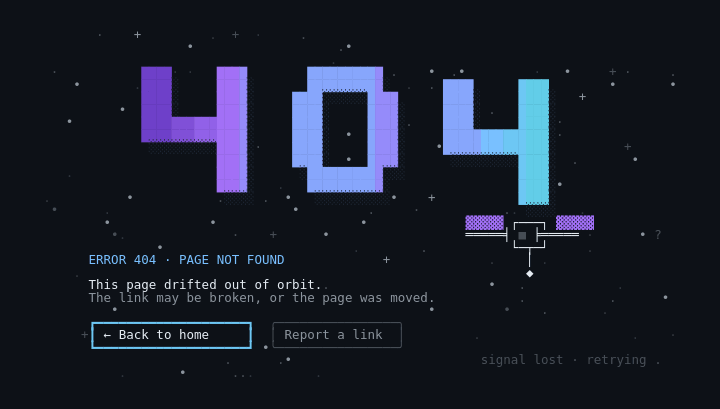

<p align="center">
  
</p>

<h1 align="center">Rohan Patil</h1>

---

```json
{
  "name": "Rohan Patil",
  "role": "CSE Student → Learning full-stack → Eventually everything",
  "location": "Mysuru, Karnataka 🇮🇳",
  "interests": [
    "space-time physics",
    "anime (Zoro supremacy 🗡)",
    "speedcubing",
    "stock markets + technical analysis",
    "building chaotic side projects"
  ],
  "current_mission": "Learn. Break things. Ship it anyway.",
  "mbti": "INTJ-T",
  "os": "EndeavourOS + Windows (dual boot)",
  "status": "🟢 open to collabs"
}
```

---

### `$ ls ./currently-working-on/`

```
🐍  python-scripts/         →  automations, small tools, learning projects
📈  trading-experiments/    →  charts, patterns, TA research  
🌌  physics-deep-dives/     →  space-time, quantum, the good stuff
⚡  electronics-lab/        →  CSE coursework + practical work
```

---

### `$ cat tech-stack.txt`

**Languages**


**Tools**


---

### `$ github --stats x-rohanpatil`

<div align="center">


</div>

<div align="center">


</div>

---

### `$ find /socials -type l`

<div align="center">

[](https://www.instagram.com/rohan_policepatil/)
[](https://www.linkedin.com/in/rohanpolicepatil)
[](https://x.com/RohanPolice8752)
[](mailto:rohanpolicepatil911@gmail.com)

</div>

---

<div align="center">

</div>
